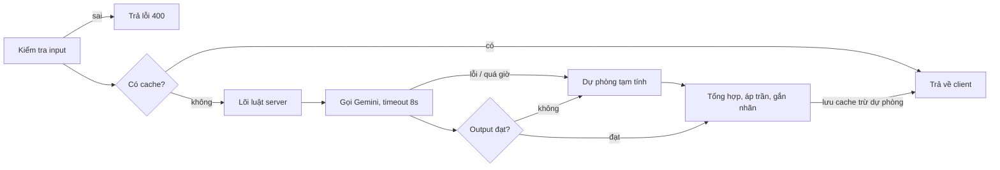

# Kiến trúc và workflow hệ thống – Việt phục Remix POC

Cập nhật: 10/10/2026

## Kiến trúc hệ thống

Một app full-stack (React + Node) chạy trong một container Cloud Run, cùng hai dịch vụ ngoài là Gemini API và Firebase. Sơ đồ để dạng chữ để giữ nguyên khi xuất markdown và khi đưa cho Gemini đọc.

```
[ Người dùng (Gen Z) ]
          │
          ▼
┌─────────────────── FRONTEND (React + Tailwind) ────────────────────┐
│ UI: mannequin SVG, bảng chọn đồ, Culture Meter     State: bộ đồ đang mặc │
│ ┌───────────────────────┐  ┌──────────────────────┐  ┌───────────────┐ │
│ │ Lõi luật (dùng chung)├──┤ Dữ liệu JSON (dùng   │  │ Firebase SDK  │ │
│ │ meter, luật, điểm tạm │  │ chung): data/*.json  │  │ (G3)          │ │
│ └───────────────────────┘  └──────────────────────┘  └───────┬───────┘ │
└────────────┬──────────────────────────────────────────────────┼─────────┘
             │ (1) Chỉ khi bấm "Xem đánh giá"                       │ (4) Đăng nhập,
             │ { event_id, gender, items }                        │ đọc/ghi giới tính
             ▼                                                    ▼
┌───────── BACKEND (Node server, Cloud Run) ─────────┐   ┌──────────────────────┐
│ POST /api/evaluate                                  │   │ FIREBASE (G3)        │
│ - Kiểm tra input, cache                             │   │ - Auth (Google)      │
│ - Chạy lại lõi luật trên cùng JSON → điểm chính thức│   │ - Firestore: chỉ hồ  │
│ - Giữ GEMINI_API_KEY, dựng prompt                   │   │   sơ giới tính       │
│ - Kiểm tra schema + can_cu_ids; lỗi → dự phòng      │   └──────────────────────┘
└────────────┬────────────────────────▲──────────────┘
             │ (2) Prompt + JSON         │ (3) { thamMy, feedback, can_cu_ids }
             ▼                           │
┌────────── GEMINI API (structured output) ────────────┐
└──────────────────────────────────────────────────────┘
```

| Tầng | Công nghệ | Nhiệm vụ |
| --- | --- | --- |
| Frontend | React, Tailwind | Giao diện, mannequin SVG, state bộ đồ; chạy lõi luật để phản hồi tức thì; dự phòng khi server lỗi |
| Lõi luật | TypeScript, hàm thuần trong `shared/core/` | Culture Meter, kiểm tra luật, tính điểm, áp trần, gắn nhãn; client và server cùng import |
| Dữ liệu tri thức | File JSON trong `data/` | Nguồn sự thật duy nhất cho món, luật, điểm, nội dung |
| Backend | Node server, deploy Cloud Run qua AI Studio | Một endpoint `/api/evaluate`: kiểm tra, cache, điểm chính thức, gọi Gemini, kiểm tra output, dự phòng |
| AI | Gemini API, SDK `@google/genai`, structured output | Chỉ đánh giá thẩm mỹ (3 mức) và viết nhận xét |
| Firebase (G3) | Authentication (Google), Firestore | Đăng nhập tùy chọn, lưu hồ sơ giới tính |

**Vì sao chọn monolith một container**

- Khớp với khung full-stack mà AI Studio Build mode dựng sẵn và deploy một chạm, nên đi cùng chiều với công cụ.
- Khóa Gemini chỉ nằm ở server.
- Lõi luật viết một lần, dùng hai nơi: không lệch kết quả, và chứng minh "thêm luật chỉ cần thêm dữ liệu".
- Không chọn: chỉ có frontend (lộ khóa); frontend + Cloud Functions riêng (thêm cấu hình, thêm chỗ hỏng); microservices, hàng đợi, RAG (quá mức cần cho POC); để Gemini quyết định mọi thứ (kết quả không ổn định, sập khi AI lỗi).

## Nguyên tắc chung

Mọi thao tác phối đồ chạy trên client; chỉ bước "Xem đánh giá" gọi server, và server tự tính lại mọi điểm từ dữ liệu của chính nó.

- **Lõi luật dùng chung:** một module hàm thuần (Culture Meter, kiểm tra luật, tính điểm, áp trần, gắn nhãn) và cùng file JSON tri thức, import ở cả client và server.
- **Client:** phản hồi tức thì, không gọi mạng khi remix.
- **Server:** một endpoint `POST /api/evaluate`; giữ khóa Gemini; không tin điểm hoặc luật do client gửi lên.
- **Firebase (giai đoạn G3):** client gọi thẳng SDK; Firestore chỉ lưu hồ sơ giới tính.
- **Hình trang phục:** SVG, đổi màu bằng cách tô lại, không dùng PNG theo từng màu.

## 1. Khởi tạo ứng dụng

1. Người dùng mở ứng dụng.
2. Client nạp file JSON tri thức đóng gói sẵn (Source, Item, Event, Rule, Preset) vào bộ nhớ.
3. Xác định giới tính:
   - G0–G2 (chế độ khách): hiển thị màn chọn Nam/Nữ, lưu theo phiên.
   - G3: nếu đã đăng nhập Google, client đọc giới tính từ Firestore; chưa có hồ sơ thì hỏi rồi ghi lại. Vẫn giữ chế độ khách.
4. Hiển thị danh sách sự kiện từ dữ liệu (E1 Tốt nghiệp/Kỷ yếu, E2 Du xuân/Tết).

## 2. Chọn sự kiện và nạp preset

1. Người dùng chọn một sự kiện (ví dụ E1).
2. Client lấy preset "chuẩn" của sự kiện đó (preset chỉ theo sự kiện; giới tính chỉ quyết định biến thể dáng của áo và quần).
3. Client render mannequin và xếp các lớp SVG theo thứ tự cố định: quần, áo, giày, đội đầu, phụ kiện; tô màu theo mã màu của preset.
4. Client chạy lõi luật và hiển thị trên thẻ thông tin:
   - Culture Meter (preset chuẩn: "Chuẩn lịch sử").
   - Tên bộ đồ, ý nghĩa, nguồn trích dẫn (lấy nguyên văn từ dữ liệu).
   - Điểm tạm (phần code).

## 3. Tùy biến và phản hồi tức thì (client)

Vòng lặp này không gọi mạng; mọi thay đổi hiển thị ngay.

1. Người dùng thao tác trên tab Áo / Quần / Đội đầu / Giày / Phụ kiện:
   - Chọn món (khóa cứng duy nhất: mỗi tầng một món; món gây lỗi vẫn chọn được).
   - Chọn màu cho áo (món khác một màu cố định); bỏ chọn được đội đầu và phụ kiện.
   - Click món để xem popup 2 dòng nguồn gốc, kèm mã nguồn.
2. Client cập nhật state bộ đồ (áo mang dạng `ma_mon:ma_mau`, ví dụ `top_tac:do_son`; món khác chỉ ghi mã món) và tô lại lớp SVG.
3. Client chạy lõi luật trên state mới:
   - Đếm món hiện đại → cập nhật Culture Meter.
   - Quét bảng luật → hiển thị cảnh báo ngay trên thẻ thông tin (không dùng popup chặn thao tác): taboo màu đỏ, cảnh báo mềm, lưu ý; nội dung và nguồn lấy từ dữ liệu.
   - Tính điểm tạm phần code (văn hóa + sự kiện), ghi rõ "chưa gồm thẩm mỹ".

## 4. Đánh giá (server + Gemini)

Nhãn phong cách chỉ được gắn sau khi có điểm thẩm mỹ và đã áp trần, vì nhãn phụ thuộc tổng điểm.

1. Người dùng bấm "Xem đánh giá".
2. Client gửi `POST /api/evaluate` với `{ event_id, gender, items: ["top_tac:do_son", "bot_lua_trang", "shoe_sneaker", ...] }`. Không gửi điểm hay luật.
3. Server kiểm tra input: sự kiện, giới tính, mã món và mã màu có trong dữ liệu; mỗi tầng tối đa một món; Áo, Quần, Giày dép bắt buộc. Sai thì trả lỗi 400.
4. Server tạo khóa cache từ `event_id + gender + items có màu` (đã sắp xếp). Có cache thì trả ngay, bỏ qua bước 5–10.
5. Server chạy lõi luật trên JSON của chính nó: cờ `isTaboo`, luật kích hoạt, điểm văn hóa (0–40), điểm sự kiện (15 hoặc 30), số món hiện đại (kể cả món gây lỗi). Cảnh báo mềm trừ dồn 10 điểm mỗi cái, thấp nhất 0.
6. Server dựng prompt: system instruction (rubric 3 mức, giới hạn chỉ dùng dữ liệu được đưa) + JSON gồm sự kiện, giới tính, món và màu, kết quả bước 5.
7. Server gọi Gemini bằng SDK `@google/genai` với structured output; timeout khoảng 8 giây (đo thực tế rồi chỉnh).
8. Server kiểm tra output: đúng schema, `thamMy` thuộc `tot | on | chua`, `feedback` tối đa 2 câu, mọi `can_cu_ids` có trong dữ liệu.
9. Dự phòng: nếu bước 7 lỗi hoặc quá giờ, hoặc bước 8 không đạt → `thamMy = on`, nhận xét mẫu ghép từ dữ liệu, cờ `tamTinh = true`.
10. Server tổng hợp theo thứ tự:
    1. Đổi `thamMy` ra điểm: tốt 30, ổn 20, chưa hài hòa 10.
    2. Cộng ba trụ cột.
    3. Áp trần: có `isTaboo` → tối đa 49; áo lệch sự kiện → 74; có món hiện đại → 89.
    4. Gắn nhãn theo điều kiện, xét lần lượt: taboo → Lỗi Văn hóa; áo lệch sự kiện → Lệch gu / Sai bối cảnh; không có món hiện đại → Cổ phong Chuẩn lễ (từ 90) hoặc Cổ phong Cơ bản; có món hiện đại → Remix Tinh tế (từ 75) hoặc Remix Chưa ăn ý.
    5. Ghép cảnh báo và nguồn từ dữ liệu.
11. Server lưu kết quả vào cache rồi trả về client. Kết quả dự phòng không lưu cache, để lần bấm sau còn thử gọi lại Gemini.



Cache trúng thì trả ngay; Gemini lỗi, quá giờ hoặc output không đạt đều đi vào cùng một nhánh dự phòng.

## 5. Hiển thị kết quả và xuất thẻ look

1. Client nhận kết quả tổng hợp từ server.
2. Màn đánh giá (cùng khung nhìn: mannequin bên trái, thẻ bên phải) hiển thị:
   - Điểm tổng, điểm từng trụ cột, nhãn phong cách.
   - Cảnh báo (từ dữ liệu) và nhận xét của AI.
   - Nội dung nguồn trích dẫn (không hiển thị mã thô).
   - Nhãn "Nhận định do AI viết dựa trên dữ liệu đã duyệt" và "Dữ liệu minh họa POC, cần thẩm định"; nếu `tamTinh` thì ghi "điểm thẩm mỹ tạm tính".
   - Nút báo sai (mở Google Form, link đặt trong file cấu hình).
3. Người dùng bấm "Lưu kết quả".
4. Client chụp vùng mannequin + thẻ thành PNG bằng thư viện chụp DOM (ví dụ html2canvas hoặc html-to-image). Thử sớm từ G0 vì thư viện loại này hay lỗi với SVG và font tiếng Việt.
5. Trình duyệt tải ảnh về máy. Không lưu lookbook lên Firestore trong POC.

## Cấu trúc thư mục

Giữ khung mặc định của AI Studio; ba thư mục cốt lõi `data/`, `shared/core/`, `public/assets/svg/` và quy ước tên file hình là bắt buộc. Mọi nội dung và hình bổ sung sau chỉ thay vào `data/` hoặc `public/assets/svg/`, không sửa code.

```
/
├─ data/                    Nội dung và cấu hình (client + server cùng đọc)
│  ├─ events.json
│  ├─ items.json
│  ├─ colors.json
│  ├─ compatibility.json
│  ├─ rules.json
│  ├─ presets.json
│  ├─ scoring.json          Trọng số, trần, nhãn, ngưỡng Culture Meter
│  ├─ gemini.json           System instruction trong app, rubric, câu nhận xét dự phòng
│  └─ app-config.json       Link Google Form báo sai, timeout, chữ giao diện cố định
├─ shared/core/             Lõi luật: hàm thuần dùng chung
│  ├─ types.ts
│  ├─ meter.ts
│  ├─ rules.ts
│  ├─ score.ts
│  └─ label.ts
├─ server/
│  ├─ index.ts              Route /api/evaluate
│  ├─ evaluate.ts
│  ├─ gemini.ts
│  └─ cache.ts
├─ public/assets/svg/       Tên file = mã món, cùng viewBox="0 0 400 800"
│  ├─ mannequin/            nu.svg, nam.svg
│  ├─ nu/                   Áo, quần dáng nữ
│  ├─ nam/                  Áo, quần dáng nam
│  └─ chung/                Đội đầu, giày dép, phụ kiện
├─ src/                     Giao diện React (.tsx)
│  ├─ screens/
│  ├─ components/
│  └─ lib/                  api.ts, firebase.ts, exportCard.ts
├─ docs/                    RULES.md, file ý tưởng, workflow, kế hoạch
├─ .gitignore               Chặn node_modules/, dist/, .env, .env.* (trừ .env.example)
└─ .env.example             GEMINI_API_KEY= (không có giá trị)
```

## Dự phòng và hợp đồng dữ liệu

Demo không bao giờ trắng màn hình: mỗi tầng lỗi đều có kết quả thay thế.

| Tình huống | Xử lý |
| --- | --- |
| Gemini lỗi, quá giờ, hoặc output không đạt kiểm tra | Server dùng dự phòng, trả kết quả "tạm tính" |
| Server không gọi được (mất mạng, lỗi deploy) | Client hiển thị điểm từ lõi luật của mình, thẩm mỹ = 20 "tạm tính", nhận xét mẫu |
| Đăng nhập hoặc Firestore lỗi | Chuyển sang chế độ khách, chọn giới tính theo phiên |
| Chụp ảnh thẻ look lỗi | Báo lỗi nhẹ, kết quả đánh giá vẫn hiển thị |

**Request** `POST /api/evaluate`

```json
{ "event_id": "E1", "gender": "nu",
  "items": ["top_tac:do_son", "bot_lua_trang", "shoe_sneaker"] }
```

**Response**

```json
{ "tongDiem": 89, "nhan": "Remix Tinh tế (Modern Fusion)",
  "diem": { "vanHoa": 40, "suKien": 30, "thamMy": 20 },
  "isTaboo": false, "cultureMeter": "cach_tan",
  "canhBao": [{ "rule_id": "R04", "loai": "note", "noiDung": "...", "nguon_ids": ["S02"] }],
  "feedback": "...", "can_cu_ids": ["shoe_sneaker", "R04"],
  "tamTinh": false }
```

Ví dụ: 40 + 30 + 20 = 90, có sneaker nên bị trần 89, nhãn Remix Tinh tế. Tên trường là bản nháp; chốt cùng giai đoạn dữ liệu.
